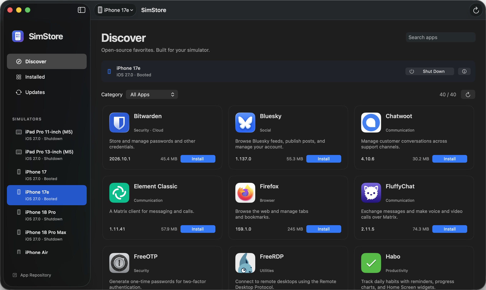
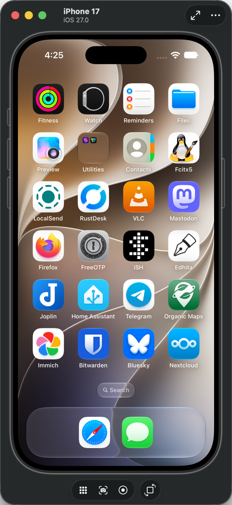

# SimStore

SimStore is a macOS app for discovering and managing prebuilt open-source iOS Simulator apps on Apple Silicon Macs.

Download SimStore from [GitHub Releases](https://github.com/iSimStore/simstore/releases) or use [Homebrew tap](https://github.com/iSimStore/homebrew-tap).

Browse app recipes and Simulator builds in [simstore-builds](https://github.com/iSimStore/simstore-builds).

  
  

